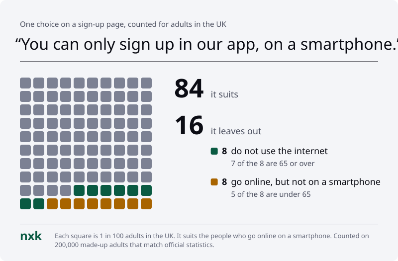

<h1 align="center">
  <picture>
    <source media="(prefers-color-scheme: dark)" srcset="assets/logo-dark.svg">
    
  </picture>
</h1>

<!--
  The launch video, built with `node assets/src/video.ts` and uploaded to albri/nxk#6: GitHub plays a video in a
  README only when it is an uploaded attachment, never a file in the repository. To change it, build it again,
  drag out/nxk-launch.mp4 into a comment box on an issue or pull request, and put the link it gives here.
-->

https://github.com/user-attachments/assets/d8e1574c-85b2-46aa-8094-66999a137cbb

<p align="center">
  <a href="https://github.com/albri/nxk/actions/workflows/test.yml"></a>
</p>

<p align="center">
  <a href="#install">Install</a> ·
  <a href="#what-to-ask-it">What to ask it</a> ·
  <a href="#how-it-works">How it works</a> ·
  <a href="#the-evidence">The evidence</a> ·
  <a href="#the-made-up-people">The made-up people</a> ·
  <a href="#scans">Scans</a> ·
  <a href="#faq">FAQ</a>
</p>

**Ask a question about people, and nxk answers it from the whole country: who
would want something, how many of them there are, where they live, and every
breakdown in between. Each answer is counted on 200,000 people built to match
official statistics, and every figure says where it came from.**

nxk is a plugin for Claude. It gives Claude 200,000 made-up adults for the UK
and 200,000 for the US, and tools to count them and put questions to them.
[PersonaGen](https://personagen.dev) built them so that, as a group, they match
official statistics and large surveys on age, money, work, health, internet
use and more. So if about 22 in every 100 of them are retired and free on
weekday mornings, about 22 in every 100 real adults are too.

A model asked directly can tell you who it thinks would want something. nxk
counts them. Every finding comes with its size in real adults or firms, its
place, its breakdown by any of 150 facts, and the big groups nothing serves.
Not only "younger people", but private renters under 35 in the North West who
work shifts. Not only "small firms", but how many firms of 10 to 49 staff
there are in each industry, where you sell.

<p align="center">
  <picture>
    <source media="(prefers-color-scheme: dark)" srcset="assets/idea-dark.svg">
    
  </picture>
</p>

One count, for one choice on a sign-up page. The top line is 16 in every 100
adults left out. The breakdown says who they are: half are offline, nearly all
of them 65 or over, and half go online but not on a smartphone, most of them
under 65. Two groups, with two different fixes.

## Install

In Claude Code (2.1.275 or later, with Node 22.18 or later), type:

```text
/plugin install nxk --marketplace albri/nxk
```

Counting needs nothing else. For [scans](#scans), add a Google AI Studio key
when the plugin asks for its settings, or later with
`/plugin configure nxk@nxk`. Then ask a question:

```text
/nxk:research Who else could our evening yoga classes in Leeds be for?
```

## What to ask it

Three commands, or the same in your own words ("ask nxk how many firms in the
North West would pay for this"). A question, a policy or a plan needs no code.
Research before you decide, a second look once something is written, and a
panel to see who is behind a count. After the command, write what you would
tell a colleague:

- `/nxk:research`: your question, where you sell, and a budget for scans if
  you like ("up to $1"). Counts are free; with no budget, it tells you what a
  scan would cost and asks before it sends anything. One budget for every
  request can go in the plugin's settings (`/plugin configure nxk@nxk`).
- `/nxk:look`: what to read (a file such as `site/join.html`, or "the plan
  above"), and your goal if you like.
- `/nxk:meet`: the group in your own words, and a page to walk them through if
  you like.

| You ask | nxk comes back with |
| --- | --- |
| <picture><source media="(prefers-color-scheme: dark)" srcset="assets/icons/research-dark.svg"></picture> `/nxk:research` how many people like this live here? | A count, about how many real adults it stands for, and its breakdown by any fact: age, money, work, home, health, internet use, habits. Free, in seconds |
| <picture><source media="(prefers-color-scheme: dark)" srcset="assets/icons/research-dark.svg"></picture> `/nxk:research` who would want this? | Your idea written a few ways to whoever pays, which groups lean in to each, how many of them there are and where, and the big groups none of them suits |
| <picture><source media="(prefers-color-scheme: dark)" srcset="assets/icons/research-dark.svg"></picture> `/nxk:research` which of these prices or versions would people take? | Which groups lean to each, how many of them there are, and how strong each finding is |
| <picture><source media="(prefers-color-scheme: dark)" srcset="assets/icons/research-dark.svg"></picture> `/nxk:research` which businesses would pay for this? | Firms counted as firms, by industry, size and region, and which kinds lean in |
| <picture><source media="(prefers-color-scheme: dark)" srcset="assets/icons/look-dark.svg"></picture> `/nxk:look` at a sign-up, checkout, pricing page or booking form | Groups the page isn't speaking to that could be customers too, and any choice that shuts out a lot of people |
| <picture><source media="(prefers-color-scheme: dark)" srcset="assets/icons/look-dark.svg"></picture> `/nxk:look` at a policy, a message to customers or a plan | Who it suits, who else it could, and what Claude would change if you say yes |
| <picture><source media="(prefers-color-scheme: dark)" srcset="assets/icons/meet-dark.svg"></picture> `/nxk:meet` private renters in Manchester under 35 | The group counted, and a few of them drawn at random, each as a card of their own facts |
| <picture><source media="(prefers-color-scheme: dark)" srcset="assets/icons/meet-dark.svg"></picture> `/nxk:meet` the people the sign-up leaves out, and walk them through site/join.html | The same cards, and each person's walk through the page: where they would stop, and what would keep them |

A count looks like this. Private renters in the North West of England, split
by age and by shift work, against all adults:

```text
Rented from a private landlord or letting agency, and North West England: 3507 people,
1.8% of adults (give or take 0.1); about 970,000 of the adults in the UK (give or take
33,000; the share of the generated people times the ONS mid-2025 estimate, 55,484,667
adults in the UK). Share of the group, then of all adults:

identity.age_years [A]
  middle value 34 against 48
   19%   10%  18 to 24
   31%   17%  25 to 34
   23%   17%  35 to 44
   12%   15%  45 to 54
    8%   16%  55 to 64
    4%   12%  65 to 74
    2%   12%  75 or more

work.shift_work [B]
    9%    7%  Works shifts most of the time
    2%    2%  Works shifts occasionally
   55%   51%  No shift work
   35%   41%  Not in employment
```

The adults figure is nxk's own step: the share of the made-up people times the
ONS's count of adults in the UK (in the US, the Census Bureau's). The letter
beside each fact says where that fact comes from ([the made-up
people](#the-made-up-people)).

## How it works

<p align="center">
  <picture>
    <source media="(prefers-color-scheme: dark)" srcset="assets/how-it-works-dark.svg">
    
  </picture>
</p>

Each command hands your question to one of nxk's agents, which works in its
own context and hands back only its result. Until you ask, nxk's tools are
not loaded, so Claude works, and costs, exactly as it would without nxk.

<picture><source media="(prefers-color-scheme: dark)" srcset="assets/icons/research-dark.svg"></picture> **Research** (`/nxk:research`) is the main way in. A question of how many,
where, or how a group breaks down is answered with counts. A question of who
would want something gets a [scan](#scans): nxk writes the idea a few ways to
whoever pays for it, finds which groups lean in to each, counts them where you
sell, then follows the strongest leads, splitting a group to find who inside
it is keenest and checking who already serves it. It comes back with findings:
strong leads first, each sized and broken down, then at most two leads to
test, the groups nothing serves (people keener than most on doing the job
themselves, whom every offer misses),
and the cheapest real test that would tell the leading two apart.

<picture><source media="(prefers-color-scheme: dark)" srcset="assets/icons/look-dark.svg"></picture> **Second look** (`/nxk:look`) reads a page, a policy, a letter or a plan with
the whole country in mind, and comes back the way a sharp colleague would:
at most three points, or one line saying nothing is worth raising.

```text
Worth considering:
- A way out of the twelve months: a year's contract with no way out is harder for about 40 in every 100 adults in Cardiff, who find money hard or are just getting by (counted). Say yes and I'll add an early exit with 30 days' notice for moving away or losing a job.
```

<picture><source media="(prefers-color-scheme: dark)" srcset="assets/icons/meet-dark.svg"></picture> **Panel** (`/nxk:meet`) puts faces to a count. It counts the group you name
and draws a few of its people at random, each a card of their own facts:

```text
3. Woman, 76. Cardiff, Wales.
   Not working: retired; last job: welfare and housing associate professionals; last worked more than 5 years ago.
   Home: owned outright; detached house or bungalow; 20 years or more at the current address; 1 vehicle available to the household.
   Money: own income £12,570 to £19,999; finding it difficult to get by financially; could not afford an unexpected necessary expense of £850; unsecured debt under £1,000.
   Online: uses the internet daily or almost daily; smartphone; tablet; smart tv; not very confident; uses social media less often than weekly.
   Shopping: usually compares prices; prefers trusted brands but will switch; sometimes buys more because of a promotion; prefers contact by email; not willing to take any financial risks.
```

Ask, and each of them is walked through your page, every stop resting on a
fact on their card:

> Walk-through (imagined): She is online every day, on her phone and tablet,
> but not confident, and she takes no financial risks. She gets through her
> name and address and stops at the bank details. She would rather sign up at
> the desk, and the page doesn't say she can.
> Would keep her: "Or join at the front desk", with the opening hours.

nxk advises and you decide. Your work changes only when you say yes, and only
by that change. nxk keeps what it learns in `nxk.json` in your project, so the
next session starts from what was found, and when your real results come in
it sets them beside what it said beforehand.

### Every figure says where it came from

| Label | Meaning |
| --- | --- |
| given | You said it. |
| measured | Your own results, recorded with nxk. |
| counted | Counted on the made-up people. |
| computed | Worked out from your figures, such as how many sales you need to break even. |
| sourced | From a web page that nxk opened and checked. |
| simulated | From a scan: which groups are more likely to want something. |
| guess | Claude's own estimate, and called one. |
| imagined | Written by Claude in a made-up person's voice, from their facts. Never a figure. |

Every figure is also a record in `.nxk/log.jsonl`. Before anything reaches
you, nxk checks each figure in its reply against the record of the tool that
printed it, and sends back any figure no tool printed to be fixed. Ask Claude to turn
the findings into a page, a chart or a brief, and every figure keeps its label.

## The evidence

nxk's figures are checked against published ones. [tested.md](tested.md) has
each check in full, and each can be run again from this repository.

<p align="center">
  <picture>
    <source media="(prefers-color-scheme: dark)" srcset="assets/evidence-dark.svg">
    
  </picture>
</p>

- **The people match the census.** On 23 counts, from renters to people with
  no car, nxk's made-up US adults came within 2 points of 200,000 real adults
  from the Census Bureau's 2024 American Community Survey: all 23, the largest
  gap 0.7 points. [evals/real-us/](evals/real-us/)
- **The decision model knows who leans which way.** Twenty-two questions from
  official surveys (the Federal Reserve, the US National Center for Health
  Statistics, the ONS, the Food Standards Agency and others), each published
  by age, income, home, education, work and more: 345 clear differences
  between groups. Asked one fact at a time, as a scan asks, the model put 327
  of them the right way round: 95 in every 100.
  [evals/surveys/](evals/surveys/)
- **Scans point the right way on real products.** Thirty-two existing products
  and activities, from social apps to premium bonds, described without their
  names and scanned in nxk's own words, against who regulators publish really
  uses each: 622 clear differences between groups. The scan put the group that
  uses each more ahead in 559 of them: 90 in every 100.
  [evals/products/](evals/products/)

nxk is built to give direction and size: who leans in, and how many of them
there are. It leaves the forecast of how many will buy to your own results.

Behind that, about 290 tests of the scripts, the server and the hooks run on
every change, and [evals/](evals/) sends each of nxk's commands in real Claude
Code sessions and grades what comes back against checks written before the
run.

## The made-up people

[PersonaGen](https://personagen.dev) is my persona generator. It made the
200,000 people for each country, and they ship inside the plugin. Each person
has 150 facts, from their region and local area to their work, money, home,
health, habits and attitudes, and each makes sense on their own: their age,
work, income, home and health fit together. The whole group matches the
country: the share of renters, of shift workers, of people who have never
used the internet, of people who could not pay an unexpected bill. Doing both
at once is the hard part.

Every count says about how many real adults it stands for, scaled to the
official adult population: the 16 in every 100 UK adults in the figure above
are about 9,100,000 people. Each person in work also stands for their share of
their employer, so a question whose buyer is a business is counted in firms,
by industry, size and place. With a PersonaGen key, nxk draws extra people for
a group too small to count well.

Beside every count, a letter says where that fact comes from:

| Letter | Where it comes from | Example |
| --- | --- | --- |
| A | Official statistics, such as the census | Age, home, work |
| B | Other published surveys | Attitude to financial risk |
| C | PersonaGen's own estimate, where no survey exists | How a person chooses between brands |

[One made-up person in full](examples/personagen.md)

## Scans

Every count works without a scan. A scan adds which groups are more likely to
want something.

A scan uses a decision model: an AI model that, given a question and its
possible answers, says how likely each answer is. nxk asks it about one fact
at a time ("someone who rents their home sees this page: what do they do
next?"), then gives each of the 200,000 people an answer built from all their
facts. So a scan's result is counted and broken down like any other count: by
age within income, by region, by firms.

Scans run on Google's `gemini-decision-1`, on your own Google AI Studio key;
nxk has no charges of its own. On Google's paid tiers a scan of one version
costs about 2 US cents, and the Free Tier costs nothing and runs slower. nxk
shows the cost before it sends anything and stops at a limit you set.
[mcp/guides/scan.md](mcp/guides/scan.md) has the settings.

## FAQ

<details>
<summary>Why not just ask Claude who would want it?</summary>

Claude can tell you who it thinks would want something. What it cannot do is
count. nxk's answers come from 200,000 people with 150 facts each, so every
finding has a size, a place and a breakdown: how many of a group live where
you sell, how a lean splits by age within income, how many firms of a given
size there are, and which big groups nothing suits.

</details>

<details>
<summary>Why does a count of made-up people tell me about real people?</summary>

The group is built to match published statistics, so a share in the group is
close to the share among real adults: on the US census survey, within 2
points on all 23 counts checked. A count reads many tables at once: people who
rent, work shifts and have no smartphone, which no single table shows.

</details>

<details>
<summary>Can a model really say how people would react?</summary>

It can say which way groups lean, which is what nxk asks of it. Against 22
official surveys, the decision model put 95 in every 100 differences between
groups the right way round, and against 32 existing products the scan put the
group that really uses each more ahead in 90 in every 100.

</details>

<details>
<summary>My customers are not all adults. Does it still help?</summary>

Yes. Tell Claude who your customers are, such as renters in Leeds or gym
members, and every count is made among them. If you know your customers'
shares (how many are over 65, say), nxk weights its counts to match.

</details>

## More

| File | What it is |
| --- | --- |
| [tested.md](tested.md) | The evidence in full: each check, its method and how to run it again |
| [mcp/README.md](mcp/README.md) | The server: every tool, the file it keeps (`nxk.json`) and the hooks |
| [docs/architecture.md](docs/architecture.md) | How nxk is built: the parts, how a tool call flows, and the rules the code keeps |
| [mcp/guides/](mcp/guides/) | The method nxk's agents follow, such as [research](mcp/guides/research.md) and [the second look](mcp/guides/second-look.md) |
| [evals/](evals/) | The cases, the checks against published figures, and how to run them |

If you used nxk on something real, or a tool confused Claude,
[open an issue](https://github.com/albri/nxk/issues). Do not include API keys.

## Development

nxk is an MCP server (the standard way to give Claude tools), three agents,
three commands and three hooks, in TypeScript that Node runs as it is: no
build step and no runtime dependencies. A few choices carry most of the
weight:

- **The method is in the tools.** A step refuses to run until the steps before
  it are done, and each tool's output names the next step.
- **Every figure is a record.** The checks on nxk's writing and the hooks read
  the records in `.nxk/log.jsonl`, never the tools' text.
- **Out of the way until asked.** nxk's tools load only when one of its agents
  calls for them.
- **Paid calls are capped.** A scan shows its cost before it sends anything and
  stops at the limit you set.

You need Node 22.18 or later, which runs the `.ts` files directly. `npm install`
adds the development tools: oxlint, oxfmt and TypeScript 7's checker, each at
the exact version in `package.json`. There is no lockfile on purpose: Claude
Code installs a plugin's packages whenever it ships one, and these tools would
then land in every owner's install.

```bash
claude --plugin-dir .   # this checkout as the plugin, for one session
npm test                # the tests of the scripts, server, hooks and eval runner
npm run check           # the format check, lint, the type check and the tests, as CI runs them
npm run lint            # oxlint: its correctness rules, and a few more
npm run typecheck       # TypeScript 7 in strict mode; it only checks, as Node strips the types itself
npm run format          # oxfmt, at 120 columns
```

The tests need no key and send nothing: local servers stand in for the
decision model and PersonaGen. The test workflow runs the format check, lint,
the type check and the tests on pull requests and on main, on Node 22.18 and on
the newest Node 22.

| Folder | What it holds |
| --- | --- |
| `mcp/` | The server, its tools, the next-step hints, and the guides |
| `agents/`, `skills/` | The researcher, the second look and the panel, and the three commands that start them |
| `scripts/` | The engine: a script for each tool, the checks on nxk's writing in `checks/`, and `launch.mjs`, which checks the Node version before the server or a hook starts |
| `hooks/` | The Claude Code hooks |
| `maps/` | The made-up people, built by `scripts/build-maps.ts` |
| `evals/` | The cases, the runner, and the checks against published figures |
| `assets/src/` | Draws the logo, figures and icons on this page, renders the launch video, and keeps the counts behind them |
| `docs/` | How nxk is built |

The evals run real Claude Code sessions on your own Claude account, and their
scans on your own key, so they cost money; `--plan` prices a run first, and
the runner starts no case past `--max-usd`.
[evals/README.md](evals/README.md) has the options.

The logo, figures and icons are drawn by `assets/src/build.ts` from
`assets/src/data/`. The opening figure's numbers come from
`node assets/src/count.ts`, which keeps every command with its output in
`assets/src/data/idea-counts.txt`, and the evidence figure's from the checks'
own results in `evals/`. The build measures text in a headless browser; the
top of `build.ts` says what it needs. The launch video is rendered by
`node assets/src/video.ts` from the same counts and results, with its sound
synthesised in code; the top of `video.ts` says how.

## Licence

The code is MIT: see [LICENSE](LICENSE). The made-up people are built from
public statistics, such as those of the ONS and the US Census Bureau, each
under its own licence:
[PersonaGen's data sources page](https://personagen.dev/docs/data-sources)
lists every publisher and dataset. Contains public sector information licensed
under the
[Open Government Licence v3.0](https://www.nationalarchives.gov.uk/doc/open-government-licence/version/3/).
