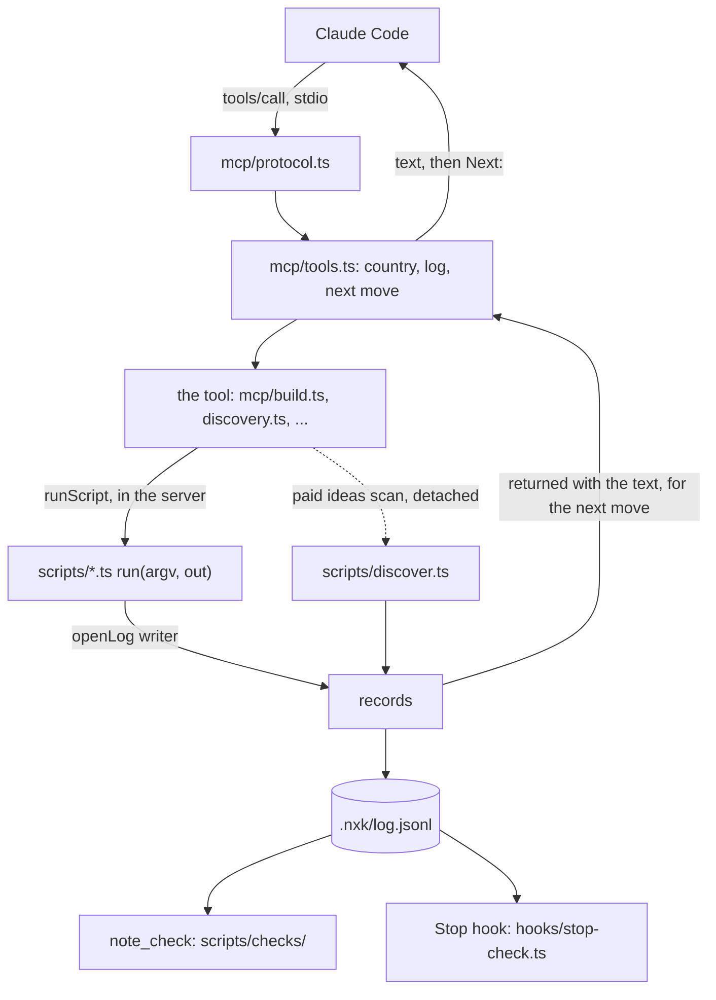

# How nxk is built

nxk is a Claude Code plugin: one MCP server, three hooks, the guides the model reads, and 200,000 generated people for
each of the UK and the US. The people are made-up adults that PersonaGen builds so that, as a group, they match
official statistics; a count of them stands for a share of real adults. It is TypeScript that Node (22.18 or later)
runs as it is, with no build step and no runtime dependencies. This page is for someone reading the code: the parts, how a tool call flows, and the rules the code
keeps.

The code and the guides call the person Claude works for, whose product or business it is, the owner. The words nxk
uses in one sense each are listed in [mcp/README.md](../mcp/README.md#words); the ones this page needs are explained
where they first appear.

## The parts

| Part | Where | What it does |
| --- | --- | --- |
| MCP server | `mcp/server.ts`, `mcp/protocol.ts` | JSON-RPC over stdio, written without an SDK: the server's instructions, the tools, and a form for a question to the owner when the client can show one. No prompts: the three ways in are agents |
| Agents and skills | `agents/second-look.md`, `agents/researcher.md`, `agents/panel.md`, `skills/look/SKILL.md`, `skills/research/SKILL.md`, `skills/meet/SKILL.md` | The three ways in, each in its own context and each started only by the owner (the skills are never started by Claude on its own): the second look, with `/nxk:look` on work Claude has done (counts only; it cannot call a scan tool); research, with `/nxk:research`, which returns findings only; and the panel, with `/nxk:meet`, which counts a group and draws a few of its people as cards, with walk-throughs marked imagined |
| Tools | `mcp/knowledge.ts`, `mcp/build.ts`, `mcp/discovery.ts`, `mcp/explore.ts` | 23 tools in four groups. Knowledge (5): the product, the owner's answers, and each research question (`research_start`). Build (11): counting (`people`); more people for a narrow audience (`people_pull`, the only call to PersonaGen); the owner's terms (`terms`: what the request already settles, such as a price or a contract); the sweep (`sweep`: the big groups the customer Claude pictured leaves out); suggestions (`suggest`: points where people could be turned away, each with options, counted, and the short note of what is worth raising with the owner); a closer look at a group near a suggestion's rule (`probe`); sums (`sums`); the reply check (`note_check`); page checks (`source_check`); option scans (`options_scan`: a decision model, which returns a probability for each answer and writes no text, asked about versions of one choice); guides (`guide`). Discovery (5): ideas, idea scans, segments (groups found, reported side by side; nxk never chooses one). Explore (2): the explorer, which names the next move in research, on the open question only; the move is planned in `mcp/explorer.ts`, which the next move after other tools reads too. `mcp/tools.ts` wraps them all (below) |
| Engine scripts | `scripts/*.ts` | One script for each tool that counts or checks (`people`, `sweep`, `terms`, `probe`, `suggest`, `sums`, `note`, `source`, `pull`, `rows`, `scan`, `discover`, `deal`; `suggest` is split into `suggest-form.ts` (reading the suggestions), `suggest-count.ts` (counting the options), `suggest-rule.ts` (the rule and close calls) and `suggest-print.ts` (lines, the note and records)), and the modules they share: `population.ts` (the people), `groups.ts`, `scan-answers.ts`, `businesses.ts`, `product.ts` (`nxk.json`), `decision-model.ts` (which model and key a scan uses), `decision-send.ts` (sending to it, which the survey check shares), `format.ts` (how figures are written), `cli.ts` (how a script runs), `log.ts` and `records.ts` |
| Checks | `scripts/checks/` | The registry of note_check, the tool that checks Claude's reply before the owner sees it: 31 checks, each with a kind that says whether it may fail a reply (one fails a figure in a passage marked imagined) |
| Hooks | `hooks/` | Before each nxk tool, and when Claude or one of nxk's agents stops |
| Knowledge base | `nxk.json` in the owner's project | What the product is, who it is for, what the owner said, the suggestions made, research (each question with its own scans, segments and explorer state), and real results. Every entry says where it came from. `scripts/product.ts` reads and writes it |
| People | `maps/` | For each country, `<country>.json` (150 facts, their values, tiers and shares of adults) and `<country>-people.bin.gz` (the 200,000 people, packed as 16-bit entries, with list fields 15 bits to a word and each person's firm weight in two more, from which `people` with unit `firms` counts businesses; format NXKP3). `scripts/build-maps.ts` builds both from a PersonaGen release and writes the people through `packer`; only `people_pull` calls PersonaGen at run time |
| Guides | `mcp/guides/` | The method, by topic, read through the `guide` tool when a step needs it |
| Evals | `evals/` | Each of nxk's commands run in real Claude Code sessions and graded, and the checks against published figures ([evals/README.md](../evals/README.md)) |

No tool is marked to load at the start of a session: the session doing the owner's work never carries nxk's tools
in its context, and its server instructions say only to leave them to nxk's agents. The agents load the tools they use
with one tool search, first thing.

## How a tool call flows



1. `protocol.ts` takes a `tools/call`, types the arguments by the tool's schema (a model calling a tool before its
   schema has loaded sends `"true"` or a JSON string), and calls the tool.
2. `tools.ts` wraps every tool three times. `placed` settles the country: it is never assumed, the first one given is
   kept (in `nxk.json` when there is one), and a tool that counts people refuses without one. `logged` writes the
   lines of the server's own tools to the log. `nudged` adds the next move.
3. The tool checks its inputs, writes the files its script reads into the working folder's `.nxk` (`request.md`,
   `terms.json`, `suggestions.json`, `reply.md`, `pays.json` and so on, never loose in the owner's project; `.nxk`
   keeps itself out of git) and calls `runScript(script, argv, folder)` in `mcp/common.ts`.
4. `runScript` imports the script and calls its `run(argv, out, { folder, env })` in the server's process. The script
   opens its log with the kind its figures are (`openLog` in `scripts/log.ts`) and prints only through that writer.
   That kind is the figure's label: counted on the people, computed from the owner's figures, simulated by a decision
   model, or measured from the owner's own results. Each line goes to `out.print` and, as a record with its label, to
   every sink: the folder's `.nxk/log.jsonl` and a collector in `runScript`. A refusal throws `Exit` with an exit code;
   nothing calls `process.exit`.
5. `runScript` returns `{ text, error, records }`, the text cut at 45,000 characters (Claude Code saves a longer result
   to a file instead of showing it).
6. `nudged` builds one `Next: <tool> <inputs>` line, the next move: one call that digs further, which the model may
   take or not. It comes from the records the call returned and from `nxk.json` (`mcp/nudge.ts`), and is added after
   the log is written, so a next move is never taken for a figure.
7. Everything later reads records through `scripts/records.ts`, never text: note_check's checks, the Stop hook, a
   background scan's pace, and suggest's own rule that a sweep must follow terms.

The server's own tools (`product`, `segments`, `explore_next` and others) build their answer with `said()`, which
labels each line where it is made, and `logged` writes it as a run with `via: "server"`.

Every script also runs from a shell, as it does in the server. Its last line, `cli(import.meta.url, run)`, prints to
stdout and logs to `.nxk/log.jsonl` in the working folder (`NXK_LOG=off` turns that off), and its usage is the comment
at the top of the file:

```bash
node scripts/people.ts count --country=uk --who=age_years=18..34,home_tenure=rented_from_a_private_landlord_or_letting_agency
```

## Records, not re-parsed text

That count writes these records (shortened here):

```json
{"type":"run","tool":"people","via":"script","args":["count","--country=uk","--who=..."],"label":"counted","run":"9e9d2a47"}
{"type":"line","text":"age_years 18 to 34, and Rented from a private landlord ...: 16059 people, 8.0% of adults ...","label":"counted","run":"9e9d2a47"}
```

A `line` carries the kind its tool's figures are (counted, computed, simulated or measured), and a line that holds
figures of another kind carries those as `parts`. Other records say what a tool meant beyond its lines: `keep` (a line
the reply keeps as it is), `clash` (a place the request contradicts itself), `next`, terms' `open` (`{ type: "open",
topic }`, a fact only the owner can give that the request leaves open) and `owner_term` (a term the owner fixed, in
their words), `resolution` (`{ type: "resolution", key, outcome, text }`, written by a step that looks further:
`probe`, each `options_scan` read, `explore_next` once a move has been made, and `corner_split`; the outcome is
`changed`, `confirmed` or `unclear`, and the reply keeps the latest line for each key), suggest's `raise` (an item
worth raising in the note, with its line) and `close_call` (a count near the figure written down beforehand), a
scan's `paced` and `spent`, and note_check's `verdict`. The header of `scripts/records.ts` lists each one and the tool that writes
it.

No reader parses a tool's text to guess which numbers were counted, which lines to keep or how long a scan will take.
A tool knows what it means at the moment it prints. Written
down there, every reader gets the same answer, and rewording a tool's output cannot move a figure from one kind to
another.

## One process, one cache

The scripts run in the server, not a process per call, and `keptFile` in `scripts/population.ts` reads each map and people
file once a process. It keys a file by its path and checks its size and the time it was written, so a rebuilt map is
read again. What is loaded is shared and never changed: a function that needs another view of it returns a copy.
Discovery reads scan answers group by group. Laying the people out by group for that (`scripts/corners.ts`) takes a
few seconds, so each layout is kept for the people it was built from (`roomFor` in `mcp/common.ts`).

Twelve rounds of each version, alternating, a fresh server each round, on a loaded machine (medians, ms):

| Call | A process per call | In the server |
| --- | ---: | ---: |
| people count | 287 | 55 |
| sums | 44 | 2 |
| terms | 365 | 134 |
| sweep | 743 | 537 |
| suggest | 710 | 470 |
| note_check | 55 | 14 |
| first count in the UK (reads the people) | 252 | 214 |
| first count in the US (reads the people) | 263 | 223 |

Together these calls take about 0.6 of the time they took. The cost is memory: before each call ran in one server
process, the server used 54 MB, and each call's own process peaked at about 290 MB and then exited. Now the people
are held as 16-bit rows, 70 MB a country, read straight into the buffer the rows are views of. The server holds about
240 MB with the UK's people loaded and about 400 MB with both countries' (measured on a loaded machine, against 316 and
549 MB with the earlier 32-bit rows in the same rounds). Going lower needs callers to stop reading `row[f]` directly:
8-bit rows cannot hold the US fields with more than 255 values (settlement, county, the interest slots), and the
200,000 row views cost about 40 MB a country.

Running in one process asks three things of a script: it prints only through `out`, it finds every file in `folder`
(never the process's working folder), and it ends with `Exit`. A test runs two scripts at once in two folders and
checks that each answer and each log holds only its own.

## What still runs apart

- **A paid ideas scan.** `ideas_scan` starts `scripts/discover.ts` as a detached process (`background` in
  `mcp/common.ts`), so that a cancelled call or a closed session does not stop a scan that is spending the owner's
  money halfway. Its output goes to `.nxk/scans/<label>.run.log`, its records to `<label>.run.jsonl` (named by
  `NXK_RECORDS`), and `<label>.run.json` holds its process id while it runs. The call waits up to ten minutes, or not
  at all when the scan's `paced` record says it will take longer, and returns what it has. Calling again with the
  label waits and then reads the answers, sending nothing. One scan runs at a time. Option scans (`options_scan`) run
  in the server like any other script.
- **Pages.** `source_check` reads a PDF with `pdftotext`, and opens a page whose text needs a browser in a headless
  Chromium through Playwright, when they are installed.
- **Tests and evals.** The server tests start the server as a child (`mcp/testing.ts`) and speak MCP to it as a client
  would. The eval runner starts `claude -p` sessions.

## note_check and the check registry

`scripts/note.ts` builds the context for a reply: its lines, drafts and table rows; the runs in the log and the
numbers traced to each label; the owner's own figures (the request, what they typed in the session as `.nxk/asked.md`
keeps it, and `nxk.json`); the pages `source_check` opened; the files the reply delivers; and what Claude declared the
reply asks people to pay. It then runs every check in `scripts/checks/index.ts`. A check is
`{ id, kind, why, run(ctx, { fail, warn }) }`.

| Kind | What it looks for | Checks | Can fail a reply |
| --- | --- | --- | --- |
| format | text nxk defines or a tool printed, found as written | 10: `note`, `brackets`, `kept-line`, `looked-further`, `length`, `label`, `legend`, `sourced-link`, `corner-size`, `ticked-box` | yes |
| trace | a figure, found among what a tool printed, a page opened or the owner wrote | 3: `traced`, `sourced-page`, `rule-given` | yes, except `rule-given`, which warns |
| quote | words Claude declared to a tool, found where it said | 4: `terms-kept`, `clash`, `pays`, `open-fact` | yes |
| hint | a word pattern on the reply's own prose | 13: `label-words`, `owners-share`, `take-up`, `as-businesses`, `of-whom`, `everyone`, `who-decides`, `who-decides-each-size`, `firm-test`, `keen-size`, `uncounted`, `payments-read`, `invented-proof` | no: it warns |

`runChecks` turns a hint's failure into a warning: a word pattern misreads new replies too often to fail one (on 176
saved replies the owner's-share pattern flagged 21 and was right once). Where a decision matters, Claude declares the
answer to a tool, and code checks the words:

- `terms` takes `buyer` (people or businesses), and `clashes`: each side of a contradiction in the owner's words,
  checked against the request. The reply must put each clash to the owner in one point, outside any draft, with both
  sides quoted, asked as a question or marked "yours to confirm" (the same test as `open`).
- `terms` also takes `open`: the facts only the owner can give that a vague request leaves open. Each open fact is
  asked (a point with "?"), marked ("yours to confirm"), or left as a [placeholder] in what is delivered, never
  written as settled. A fact the owner has answered in `nxk.json` is not open. Names and ways to reach the business
  go in the page as [placeholders] and need no line in the reply; the reply lists only what a person pays, gets, must
  do or agrees to.
- `note_check` takes `pays`: each free trial, renewal or repeating payment the reply or its files ask for, with the
  words that tell the person. The words must be in what is delivered and say what that kind needs (what the trial
  turns into, what the renewal costs, how the payment stops).
- `terms` takes the owner's terms, each quoted from the request. `terms-kept` looks for every figure in each quote
  (a price, hours, a contract's length, a limit, an age) in the files and drafts the reply delivers, so that a term is
  built as asked and a change to it is offered, never made. A term with no figure ("pay by direct debit") cannot be
  checked this way, and the Stop hook, which does not know which files were delivered, skips this check.
- `rule-given` warns when a delivered file or draft states a rule with a figure (money, a percentage, a length of time)
  that the request, what the owner typed, `nxk.json`, the pages `source_check` opened and the project's own files never
  give, with the line. A sum of the owner's figures counts as given (a £20 joining fee and £29 a month make £49). It
  sees only rules with figures: an invented rule in words ("members may leave early if they move away") is beyond what
  code can find reliably, and the guides tell the model not to write one.
- `note` checks the "Worth considering:" note that `suggest` printed: at most three items (more fails), each item short
  (a long one warns), and a warning when `suggest` raised something and the reply has no note.
- `ideas_scan` takes a `buying_category` for every idea: `household`, asked where people live, or what an organisation
  buys it as, asked at work and read by who signs off, approves, recommends and uses it.

`length` counts only the session's own prose: `requiredLines` in `scripts/checks/form.ts` lists what it leaves out
(drafts, the note and its items, kept and look-further lines, sourced lines, and points put to the owner). Prose over about 400 words fails; a whole reply over 400 words warns. The limit is
fixed, so a check never pushes a session to cut what another check asks for, and a session cannot raise it.

`legend` makes a reply that labels figures say once, outside any draft, what each label it uses means. The meanings
are defined once in `scripts/checks/legend.ts` and shared with `requiredLines`, so the line does not count towards
the length. When it is missing, the check prints the exact line to add, built from the labels used and the country
(from the tools' `--country`, else from the reply).

`looked-further` is a format check on tool-written lines, not a declaration: each step that looked further must have
its latest `resolution` line in the reply, outside any draft. The depth report
(`scripts/depth.ts`, `evals/depth.ts`) counts these lines by outcome, so the evals show how often a step changes a
choice.

A pattern may still put a question back. `terms` returns each place its patterns read as a contradiction until Claude
lists it in `clashes` or sets it aside in `not_clashes` with a reason. A wrong pattern costs a line of why; it never
fails a reply.

note_check ends with a `verdict` record (`ready`, and the `pays` it was told). The Stop hook reads that record, not
the words of the answer.

## Hooks

| Hook | Runs | Does |
| --- | --- | --- |
| `asked.ts` | before each nxk tool | Copies what the person typed in the session into `.nxk/asked.md`, so a figure they gave counts as given. A session that never uses nxk leaves nothing behind |
| `stop-check.ts` | when Claude stops, and when nxk's agents stop | The main session is never held for nxk, which runs only when the owner starts it; an agent, or a session that used nxk's tools itself, is held once, with every reason in one note: it stopped after one look; it counted terms and ran no `suggest`; it ran `suggest` or printed figures and no reply has passed note_check since; the explorer named a move it can make; or its last message fails note_check. It reads records, never a tool's text |

## Rules the code keeps

1. **No figure without a label a tool printed.** Every figure in a reply carries one of seven labels. A counted,
   computed, simulated or measured figure must be one a tool printed under that label. A sourced figure needs a link
   that `source_check` opened and found the words on. The owner's own figures are given. Anything else is a guess and
   says so.
2. **Patterns hint; declarations decide.** A check that can fail a reply looks for something exact. Where judgement is
   needed, the model makes it and declares it to a tool, and code checks the declared words against their source.
3. **Tools say what they mean when they print.** Meaning is written as a record at the line that makes it. No reader
   parses a tool's text.
4. **A script runs the same in the server and from a shell**, with the same output, records and exit code.
5. **What is loaded is read-only.** The people and the maps are shared by every tool in the session.
6. **The country is never assumed.** A guessed country would count the wrong population under the product's name.
7. **Paid work names its cap first.** Both scans refuse to send without `max_usd`, and print the cost before sending.
8. **Tools return text only.** Claude Code shows the model a tool's structured content in place of its text, and the
   text is what says what each figure means.
9. **TypeScript with no build step.** Node strips the types as it loads each file, so what is in the repository is
   what runs: the plugin installs by cloning. That allows only syntax Node can erase (no enums, namespaces or
   parameter properties), and imports name the `.ts` file. `tsc` checks in strict mode and emits nothing. The one file
   in plain JavaScript is `scripts/launch.mjs`, which the server and the hooks start through: any Node can read it, so
   an older one is told in a line that nxk needs 22.18, rather than failing on the first `.ts` file. Shared
   shapes live with the module that owns the data: the people map in `population.ts`, nxk.json in `product.ts`, log
   lines in `log.ts`.
